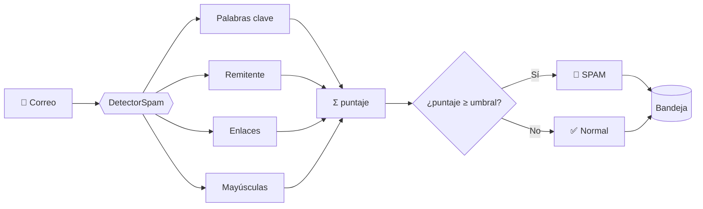
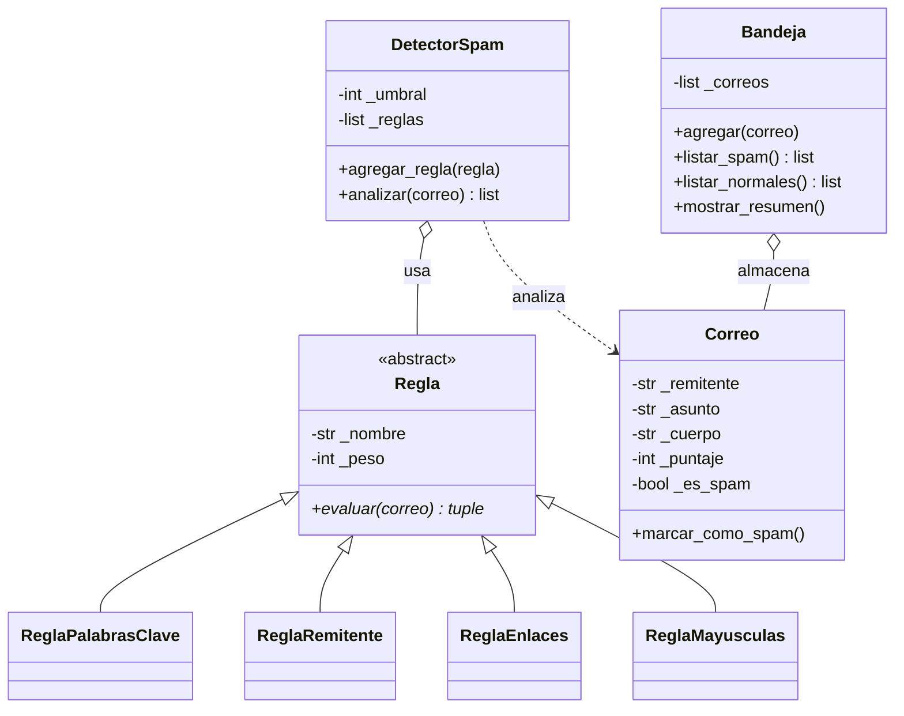
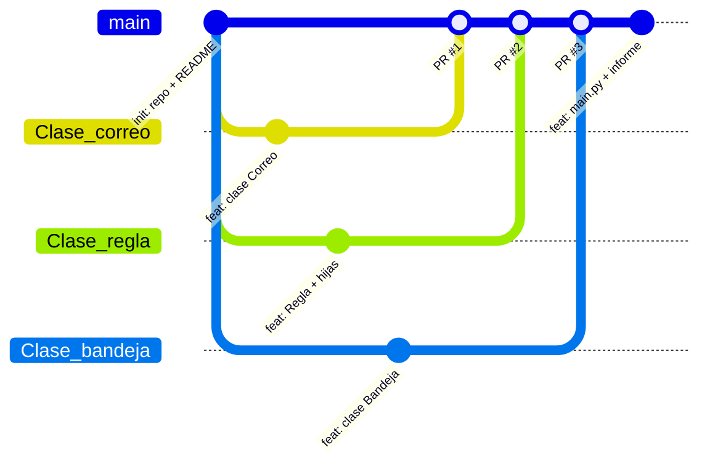

<div align="center">


# 📧 Sistema de Detección de Correos Spam

**Programación Orientada a Objetos en Python · GitHub Flow · Quarto**

*Universidad Nacional Agraria La Molina*
*Facultad de Economía y Planificación · Departamento Académico de Estadística e Informática*


**Grupo 5 · La Molina, Lima, Perú**

</div>

---

## 📑 Contenido

1. [Descripción del proyecto](#-descripción-del-proyecto)
2. [Equipo de trabajo](#-equipo-de-trabajo)
3. [Arquitectura del sistema](#-arquitectura-del-sistema)
4. [Estructura del repositorio](#-estructura-del-repositorio)
5. [Flujo de trabajo: de la rama al merge](#-flujo-de-trabajo-de-la-rama-al-merge-github-flow)
6. [Código fuente](#-código-fuente)
7. [Instalación y ejecución](#-instalación-y-ejecución)
8. [Resultados](#-resultados)
9. [Informe en Quarto](#-informe-en-quarto)
10. [Conclusiones](#-conclusiones)

---

## 🎯 Descripción del proyecto

Este proyecto implementa un **detector de correos spam** usando **Programación Orientada a Objetos (POO)** en Python. Cada correo se evalúa con un conjunto de **reglas independientes**; cada regla aporta un puntaje y un motivo, y si la suma alcanza un **umbral** el correo se clasifica como spam.

### Objetivos

- 🧱 Aplicar los pilares de la POO: **encapsulamiento, herencia, abstracción y polimorfismo**.
- 🌿 Trabajar en equipo con **Git y GitHub Flow**: una rama por funcionalidad, *pull request* y *merge* a `main`.
- 📝 Documentar el proceso y los resultados en un informe reproducible con **Quarto**.

### ¿Cómo funciona?



---

## 👥 Equipo de trabajo

| N° | Integrante |
|:--:|------------|
| 1 | Huamani Diestra, Miriam Vanessa |
| 2 | Meza Asto, Angel David |
| 3 | Chavez Cuzcano, Victor Javier |
| 4 | Alva Aquino, Brian |

**Docente:** Vargas Paredes, Ana Cecilia

---

## 🏗️ Arquitectura del sistema

### Módulos del sistema

| Módulo | Clase(s) | Responsabilidad | Pilar de POO |
|--------|----------|-----------------|--------------|
| `correo.py` | `Correo` | Guarda remitente, asunto, cuerpo, puntaje y estado | Encapsulamiento |
| `reglas.py` | `Regla` + 4 hijas | Cada regla evalúa un patrón sospechoso | Herencia, abstracción y polimorfismo |
| `detector_spam.py` | `DetectorSpam` | Aplica todas las reglas y clasifica según el umbral | Composición |
| `bandeja.py` | `Bandeja` | Guarda los correos analizados y genera el resumen | Colección de objetos |
| `main.py` | — | Integra todo y ejecuta la demostración | — |

### Diagrama de clases



### Reglas implementadas

| Regla | Qué detecta | Peso por defecto |
|-------|-------------|:----------------:|
| `ReglaPalabrasClave` | Palabras como *gratis, premio, urgente, ganaste, oferta* | 2 por palabra |
| `ReglaRemitente` | Dominios en lista negra (`promo-ya.com`, `ganadores.net`, `gratis.xyz`) | 5 |
| `ReglaEnlaces` | Más enlaces `http(s)://` que el máximo permitido (2) | 2 |
| `ReglaMayusculas` | Asunto en MAYÚSCULAS o con 3+ signos de exclamación | 3 |

> 💡 **Extensible:** para agregar una regla nueva basta con crear una subclase de `Regla` que implemente `evaluar()` y registrarla con `detector.agregar_regla(...)`. No hay que modificar `DetectorSpam`.

---

## 📁 Estructura del repositorio

```text
lp2_grupo5_EM/
├── images/
│   └── logo_UNALM.png      # Logo usado en la portada del informe
├── correo.py               # Clase Correo
├── reglas.py               # Clase abstracta Regla y reglas hijas
├── detector_spam.py        # Clase DetectorSpam
├── bandeja.py              # Clase Bandeja
├── main.py                 # Punto de entrada y demostración
├── informe.qmd             # Informe en Quarto (fuente)
├── informe.html            # Informe renderizado
├── trabajo.ipynb           # Cuaderno de trabajo
└── README.md               # Este archivo
```

---

## 🌿 Flujo de trabajo: de la rama al merge (GitHub Flow)

Para que cada integrante avance **sin pisar el trabajo de los demás**, usamos **GitHub Flow**:

- `main` siempre contiene código estable.
- Cada funcionalidad se desarrolla en **su propia rama**.
- Los cambios llegan a `main` solo mediante un **Pull Request (PR)** revisado por el equipo.



> 🌱 Convención de ramas: `Clase_<nombre>`, por ejemplo `Clase_bandeja`, la rama usada para trabajar la clase `Bandeja`.

### Paso a paso (el proceso completo)

#### 1️⃣ Clonar el repositorio (una sola vez)

```bash
git clone https://github.com/<usuario-o-organizacion>/lp2_grupo5_EM.git
cd lp2_grupo5_EM
```

#### 2️⃣ Crear una rama para tu funcionalidad

Antes de crear la rama, actualiza `main`:

```bash
git checkout main
git pull origin main
git checkout -b Clase_bandeja
```

#### 3️⃣ Trabajar y guardar cambios (*commit*)

```bash
git status                      # ver qué cambió
git add bandeja.py              # agregar solo lo que corresponde
git commit -m "feat(bandeja): agrega clase Bandeja con resumen estadístico"
```

#### 4️⃣ Subir la rama a GitHub (*push*)

```bash
git push -u origin Clase_bandeja
```

#### 5️⃣ Abrir el Pull Request

1. En GitHub aparece el botón **Compare & pull request**.
2. Base: `main` ← Compare: `Clase_bandeja`.
3. Escribe un título y una descripción de lo que hiciste.
4. Pide revisión a un compañero (**Reviewers**).

#### 6️⃣ Revisión del código

El revisor comenta, pide ajustes o aprueba (**Approve**). Si hay ajustes, haz nuevos *commits* en la misma rama y vuelve a hacer `git push`: el PR se actualiza solo.

#### 7️⃣ Merge a `main` ✅

Con el PR aprobado y sin conflictos, pulsa **Merge pull request** y confirma. Después elimina la rama con **Delete branch**.

#### 8️⃣ Sincronizar tu copia local

```bash
git checkout main
git pull origin main
git branch -d Clase_bandeja     # borra la rama local ya fusionada
```

#### 🆘 Si hay conflictos de merge

```bash
git checkout Clase_bandeja
git pull origin main            # trae los cambios de main a tu rama
# 1) abre los archivos marcados, 2) elige qué versión queda y quita <<<<<<< ======= >>>>>>>
git add <archivo>
git commit -m "fix: resuelve conflicto con main"
git push
```

### Convención de mensajes de *commit*

| Prefijo | Uso | Ejemplo |
|---------|-----|---------|
| `feat` | Nueva funcionalidad | `feat(reglas): agrega ReglaEnlaces` |
| `fix` | Corrección de un error | `fix(detector): corrige suma de puntajes` |
| `docs` | Documentación | `docs: actualiza README` |
| `refactor` | Mejora interna sin cambiar el comportamiento | `refactor(correo): usa properties` |
| `chore` | Tareas de mantenimiento | `chore: agrega .gitignore` |

### Distribución del trabajo

| Módulo | Rama sugerida | Pull Request |
|--------|---------------|--------------|
| `correo.py` | `Clase_correo` | ✅ → `main` |
| `reglas.py` | `Clase_regla` | ✅ → `main` |
| `detector_spam.py` | `Clase_detector` | ✅ → `main` |
| `bandeja.py` | `Clase_bandeja` | ✅ → `main` |
| `main.py` + `informe.qmd` | `integracion` | ✅ → `main` |

---

## 💻 Código fuente

<details>
<summary><b>📄 correo.py</b> — Encapsulamiento con atributos privados y <code>@property</code></summary>

```python
"""Módulo correo: entidad Correo con estado encapsulado."""


class Correo:
    """Representa un mensaje de correo electrónico y su estado de análisis."""

    def __init__(self, remitente: str, asunto: str, cuerpo: str):
        self._remitente = remitente
        self._asunto = asunto
        self._cuerpo = cuerpo
        self._puntaje = 0
        self._es_spam = False

    @property
    def remitente(self) -> str:
        return self._remitente

    @property
    def asunto(self) -> str:
        return self._asunto

    @property
    def cuerpo(self) -> str:
        return self._cuerpo

    @property
    def puntaje(self) -> int:
        return self._puntaje

    @puntaje.setter
    def puntaje(self, valor: int) -> None:
        if valor < 0:
            raise ValueError("El puntaje no puede ser negativo")
        self._puntaje = valor

    @property
    def es_spam(self) -> bool:
        return self._es_spam

    def marcar_como_spam(self) -> None:
        self._es_spam = True

    def __str__(self) -> str:
        estado = "SPAM" if self._es_spam else "OK  "
        return f"[{estado}] {self._puntaje:>2} pts | De: {self._remitente} | Asunto: {self._asunto}"
```
</details>

<details>
<summary><b>📄 reglas.py</b> — Clase abstracta <code>Regla</code> y reglas hijas (herencia y polimorfismo)</summary>

```python
"""Módulo reglas: clase abstracta Regla y sus especializaciones (polimorfismo)."""

import re
from abc import ABC, abstractmethod

from correo import Correo


class Regla(ABC):
    """Contrato común: toda regla recibe un Correo y devuelve (puntaje, motivo)."""

    def __init__(self, nombre: str, peso: int = 1):
        self._nombre = nombre
        self._peso = peso

    @property
    def nombre(self) -> str:
        return self._nombre

    @property
    def peso(self) -> int:
        return self._peso

    @abstractmethod
    def evaluar(self, correo: Correo) -> tuple[int, str]:
        """Devuelve (puntaje, motivo). Si no hay hallazgo: (0, '')."""


class ReglaPalabrasClave(Regla):
    """Suma `peso` por cada palabra sospechosa encontrada."""

    def __init__(self, palabras=None, peso: int = 2):
        super().__init__("Palabras clave", peso)
        self._palabras = [p.lower() for p in (palabras or
                          ["gratis", "premio", "urgente", "ganaste", "oferta"])]

    def evaluar(self, correo: Correo) -> tuple[int, str]:
        texto = f"{correo.asunto} {correo.cuerpo}".lower()
        halladas = [p for p in self._palabras if p in texto]
        if halladas:
            return len(halladas) * self._peso, f"contiene {', '.join(halladas)}"
        return 0, ""


class ReglaRemitente(Regla):
    """Penaliza remitentes cuyo dominio esté en una lista negra."""

    def __init__(self, lista_negra=None, peso: int = 5):
        super().__init__("Remitente sospechoso", peso)
        self._lista_negra = [d.lower() for d in (lista_negra or
                             ["promo-ya.com", "ganadores.net", "gratis.xyz"])]

    def evaluar(self, correo: Correo) -> tuple[int, str]:
        dominio = correo.remitente.lower().split("@")[-1]
        for bloqueado in self._lista_negra:
            if dominio == bloqueado or dominio.endswith("." + bloqueado):
                return self._peso, f"remitente en lista negra ({bloqueado})"
        return 0, ""


class ReglaEnlaces(Regla):
    """Penaliza correos con más enlaces que el máximo permitido."""

    def __init__(self, max_enlaces: int = 2, peso: int = 2):
        super().__init__("Enlaces", peso)
        self._max_enlaces = max_enlaces

    def evaluar(self, correo: Correo) -> tuple[int, str]:
        enlaces = re.findall(r"https?://\S+", correo.cuerpo)
        if len(enlaces) > self._max_enlaces:
            return self._peso, f"tiene {len(enlaces)} enlaces"
        return 0, ""


class ReglaMayusculas(Regla):
    """Penaliza asuntos en mayúsculas o con exceso de exclamaciones."""

    def __init__(self, peso: int = 3):
        super().__init__("Mayúsculas y exclamaciones", peso)

    def evaluar(self, correo: Correo) -> tuple[int, str]:
        asunto = correo.asunto
        motivos = []
        if asunto.isupper() and len(asunto) > 3:
            motivos.append("asunto en mayúsculas")
        if asunto.count("!") >= 3:
            motivos.append("muchos signos de exclamación")
        if motivos:
            return self._peso, ", ".join(motivos)
        return 0, ""
```
</details>

<details>
<summary><b>📄 detector_spam.py</b> — Orquestador de las reglas</summary>

```python
"""Módulo detector_spam: orquesta las reglas y clasifica según un umbral."""

from correo import Correo
from reglas import Regla


class DetectorSpam:
    """Aplica un conjunto de reglas y marca como spam al superar el umbral."""

    def __init__(self, umbral: int = 5):
        self._umbral = umbral
        self._reglas: list[Regla] = []

    @property
    def umbral(self) -> int:
        return self._umbral

    def agregar_regla(self, regla: Regla) -> None:
        self._reglas.append(regla)

    def analizar(self, correo: Correo) -> list[str]:
        total = 0
        motivos = []
        for regla in self._reglas:
            puntaje, motivo = regla.evaluar(correo)  # polimorfismo
            total += puntaje
            if motivo:
                motivos.append(f"{regla.nombre}: {motivo}")
        correo.puntaje = total
        if total >= self._umbral:
            correo.marcar_como_spam()
        return motivos
```
</details>

<details>
<summary><b>📄 bandeja.py</b> — Almacén de correos y resumen estadístico</summary>

```python
"""Módulo bandeja: almacena correos analizados y genera el resumen."""

from correo import Correo


class Bandeja:
    """Administra los correos analizados y reporta estadísticas."""

    def __init__(self):
        self._correos: list[Correo] = []

    def agregar(self, correo: Correo) -> None:
        self._correos.append(correo)

    def listar_spam(self) -> list[Correo]:
        return [c for c in self._correos if c.es_spam]

    def listar_normales(self) -> list[Correo]:
        return [c for c in self._correos if not c.es_spam]

    def mostrar_resumen(self) -> None:
        total = len(self._correos)
        spam = len(self.listar_spam())
        print("=== RESUMEN DE BANDEJA ===")
        print(f"Total de correos : {total}")
        print(f"Spam             : {spam}")
        print(f"Normales         : {total - spam}")
        if total:
            print(f"Porcentaje spam  : {spam / total * 100:.1f}%")
```
</details>

<details>
<summary><b>📄 main.py</b> — Punto de entrada y demostración</summary>

```python
"""Punto de entrada: integra todas las clases y ejecuta una demostración."""

from bandeja import Bandeja
from correo import Correo
from detector_spam import DetectorSpam
from reglas import ReglaEnlaces, ReglaMayusculas, ReglaPalabrasClave, ReglaRemitente


def main() -> None:
    detector = DetectorSpam(umbral=5)
    for regla in (ReglaPalabrasClave(), ReglaRemitente(), ReglaEnlaces(), ReglaMayusculas()):
        detector.agregar_regla(regla)

    correos = [
        Correo("ventas@promo-ya.com", "¡¡¡GANASTE UN PREMIO GRATIS!!!",
               "Haz clic: http://a.co http://b.co http://c.co"),
        Correo("profe.vargas@lamolina.edu.pe", "Revisión del informe",
               "Adjunto la rúbrica de evaluación del trabajo grupal."),
        Correo("soporte@tienda.com", "Oferta de temporada",
               "Descuento en tu próxima compra."),
    ]

    bandeja = Bandeja()
    for correo in correos:
        motivos = detector.analizar(correo)
        bandeja.agregar(correo)
        print(correo)
        for m in motivos:
            print(f"    - {m}")

    print()
    bandeja.mostrar_resumen()


if __name__ == "__main__":
    main()
```
</details>

---

## 🚀 Instalación y ejecución

**Requisitos:** Python 3.10 o superior (se usan anotaciones como `list[str]` y `tuple[int, str]`). No requiere librerías externas.

```bash
# 1. Clonar
git clone https://github.com/<usuario-o-organizacion>/lp2_grupo5_EM.git
cd lp2_grupo5_EM

# 2. Ejecutar la demostración
python main.py
```

### Uso básico

```python
from correo import Correo
from detector_spam import DetectorSpam
from reglas import ReglaPalabrasClave, ReglaEnlaces

detector = DetectorSpam(umbral=5)
detector.agregar_regla(ReglaPalabrasClave())
detector.agregar_regla(ReglaEnlaces(max_enlaces=1))

correo = Correo("alguien@dominio.com", "Oferta urgente", "Mira http://x.co y http://y.co")
motivos = detector.analizar(correo)

print(correo)    # [SPAM] ...
print(motivos)   # lista de motivos detectados
```

---

## 📊 Resultados

Salida real de `python main.py` con tres correos de prueba (umbral = 5):

```text
[SPAM] 16 pts | De: ventas@promo-ya.com | Asunto: ¡¡¡GANASTE UN PREMIO GRATIS!!!
    - Palabras clave: contiene gratis, premio, ganaste
    - Remitente sospechoso: remitente en lista negra (promo-ya.com)
    - Enlaces: tiene 3 enlaces
    - Mayúsculas y exclamaciones: asunto en mayúsculas, muchos signos de exclamación
[OK  ]  0 pts | De: profe.vargas@lamolina.edu.pe | Asunto: Revisión del informe
[OK  ]  2 pts | De: soporte@tienda.com | Asunto: Oferta de temporada
    - Palabras clave: contiene oferta

=== RESUMEN DE BANDEJA ===
Total de correos : 3
Spam             : 1
Normales         : 2
Porcentaje spam  : 33.3%
```

| Correo | Puntaje | Clasificación | Motivos |
|--------|:-------:|:-------------:|---------|
| `ventas@promo-ya.com` — *¡¡¡GANASTE UN PREMIO GRATIS!!!* | 16 | 🚫 SPAM | Palabras clave (6) + remitente en lista negra (5) + enlaces (2) + mayúsculas/exclamaciones (3) |
| `profe.vargas@lamolina.edu.pe` — *Revisión del informe* | 0 | ✅ Normal | Sin hallazgos |
| `soporte@tienda.com` — *Oferta de temporada* | 2 | ✅ Normal | Una palabra clave, bajo el umbral |

> El tercer correo muestra el efecto del **umbral**: una sola señal débil no basta para marcar spam.

---

## 📝 Informe en Quarto

El informe del proyecto está en [`informe.qmd`](informe.qmd). Cada integrante redacta su sección en el mismo archivo y se renderiza a HTML autocontenido.

```bash
# Requiere Quarto instalado: https://quarto.org
quarto render informe.qmd
```

Resultado: `informe.html`, con tabla de contenido, tema claro/oscuro y código plegable.

---

## ✅ Conclusiones

- **Modularidad:** separar el sistema en `Correo`, `Regla`, `DetectorSpam` y `Bandeja` hace que cada parte sea fácil de entender, probar y mejorar.
- **Polimorfismo en acción:** `DetectorSpam` trata a todas las reglas por igual; agregar una regla nueva no obliga a cambiar el detector.
- **Trabajo colaborativo ordenado:** una rama por funcionalidad y Pull Requests hacia `main` permiten que cada integrante avance sin interferir con el trabajo de los demás.
- **Documentación reproducible:** con Quarto, el informe se vuelve a generar con un solo comando.

### 🔭 Mejoras futuras

- Pruebas automatizadas con `pytest`.
- Cargar correos desde archivos CSV o `.eml`.
- Ajustar pesos y umbral con datos reales y medir precisión.
- Nuevas reglas, por ejemplo adjuntos sospechosos o dominios recién creados.

---

<div align="center">

**Universidad Nacional Agraria La Molina** · Lenguaje de Programación II · Grupo 5 · 2026-II

Hecho con 💚 y mucho `git commit`

</div>
