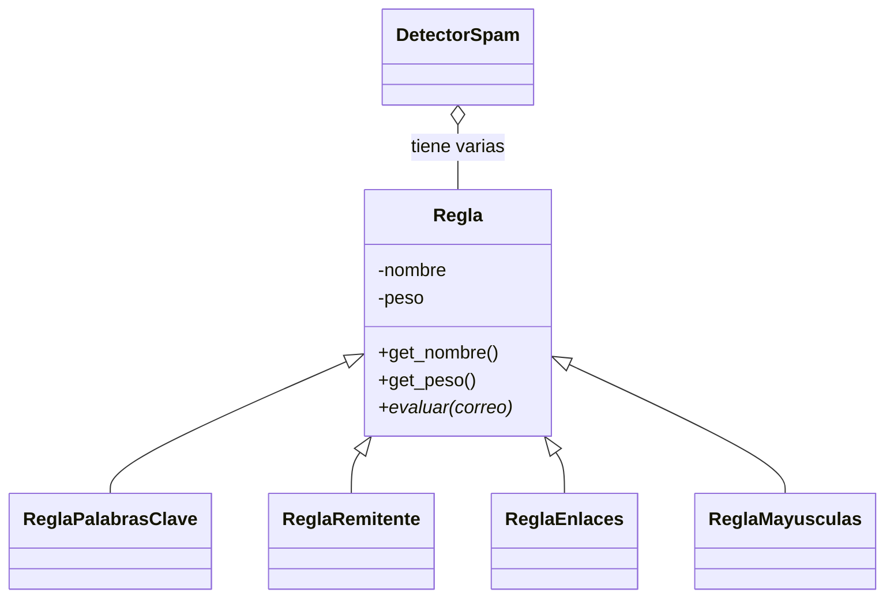

<div align="center">

# 🛡️ Módulo de Reglas

### El cerebro del Detector de Spam


*Cada regla mira el correo desde un ángulo distinto y dice: "¿esto huele a spam?"* 🕵️

</div>

---

## 📖 ¿De qué trata?

El archivo `reglas.py` contiene las **reglas de detección**. Cada regla revisa un correo y devuelve dos cosas:

| Devuelve | Significa |
|----------|-----------|
| 🔢 **Puntaje** | Qué tan sospechosa es la señal (0 si no encontró nada) |
| 💬 **Motivo** | Una frase que explica *por qué* sumó puntos |

El `DetectorSpam` suma los puntajes de todas las reglas y, si el total llega al **umbral**, marca el correo como spam. 🚫

---

## 🧬 Estructura de clases



> 💡 **Herencia:** las 4 reglas hijas heredan de `Regla`.
> 💡 **Polimorfismo:** todas implementan `evaluar(correo)`, pero cada una lo hace a su manera.

---

## 🔍 Las reglas

| | Regla | ¿Qué detecta? | Peso |
|---|-------|---------------|:----:|
| 🔑 | `ReglaPalabrasClave` | Palabras como *gratis*, *premio*, *urgente*, *ganaste*, *oferta* | 2 (por palabra) |
| 📮 | `ReglaRemitente` | Remitentes de dominios en lista negra | 5 |
| 🔗 | `ReglaEnlaces` | Correos con más de 2 enlaces | 2 |
| 🔠 | `ReglaMayusculas` | Asuntos en MAYÚSCULAS o con 3+ signos `!` | 3 |

*Haz clic en cada una para ver más detalle* 👇

<details>
<summary>🔑 <b>ReglaPalabrasClave</b></summary>

<br>

Busca en el **asunto y el cuerpo** (sin importar mayúsculas) una lista de palabras típicas del spam. Suma el peso **por cada palabra** encontrada.

```python
regla = ReglaPalabrasClave(palabras=["gratis", "premio"], peso=2)
```

✅ Puedes personalizar la lista de palabras al crearla.
</details>

<details>
<summary>📮 <b>ReglaRemitente</b></summary>

<br>

Revisa si el correo del remitente termina en alguno de los dominios de la **lista negra**.

```python
regla = ReglaRemitente(lista_negra=["promo-ya.com"], peso=5)
```

🚨 Es la regla con más peso, porque un remitente conocido como malo es una señal fuerte.
</details>

<details>
<summary>🔗 <b>ReglaEnlaces</b></summary>

<br>

Cuenta los enlaces (`http://` o `https://`) del cuerpo. Si superan el máximo permitido, suma puntos.

```python
regla = ReglaEnlaces(max_enlaces=2, peso=2)
```
</details>

<details>
<summary>🔠 <b>ReglaMayusculas</b></summary>

<br>

Penaliza los asuntos escritos **TODO EN MAYÚSCULAS** o con **tres o más signos de exclamación**.

```python
regla = ReglaMayusculas(peso=3)
```
</details>

---

## 🚀 Cómo usarlas

```python
from reglas import *
from detector_spam import DetectorSpam

detector = DetectorSpam(umbral=5)

detector.agregar_regla(ReglaPalabrasClave())
detector.agregar_regla(ReglaRemitente())
detector.agregar_regla(ReglaEnlaces())
detector.agregar_regla(ReglaMayusculas())
```

---

## 🧪 Ejemplo paso a paso

Un correo con asunto `GANASTE UN PREMIO!!!`, remitente `info@promo-ya.com` y tres enlaces en el cuerpo:

| Regla | Motivo | Puntos |
|-------|--------|:------:|
| 🔑 Palabras clave | contiene gratis, premio, ganaste | **6** |
| 📮 Remitente | remitente en lista negra (promo-ya.com) | **5** |
| 🔗 Enlaces | tiene 3 enlaces | **2** |
| 🔠 Mayúsculas | asunto en mayúsculas, muchos signos de exclamación | **3** |
| | **TOTAL** | **16** |

Con un umbral de 5, `16 ≥ 5` → 🚫 **SPAM**

---

## 🛠️ ¿Cómo agrego una regla nueva?

<details>
<summary>👉 Haz clic para ver la receta</summary>

<br>

1. Crea una clase que **herede de `Regla`**.
2. Llama a `super().__init__(nombre, peso)` en el constructor.
3. Implementa `evaluar(self, correo)` y devuelve `(puntaje, motivo)`.
4. Agrégala al detector con `agregar_regla()`.

```python
class ReglaAdjuntos(Regla):
    def __init__(self, peso=2):
        super().__init__("Adjuntos sospechosos", peso)

    def evaluar(self, correo):
        if ".exe" in correo.get_cuerpo():
            return self._peso, "menciona un archivo .exe"
        return 0, ""
```

¡Y listo! No hay que tocar el resto del código. ✨
</details>

---

## ✅ Conceptos de POO aplicados

- [x] **Clases y objetos**
- [x] **Constructores** (`__init__`)
- [x] **Encapsulamiento** (atributos privados con `_` y getters)
- [x] **Herencia** (`Regla` → 4 reglas hijas)
- [x] **Polimorfismo** (`evaluar()` distinto en cada hija)
- [x] **Listas** (el detector guarda sus reglas en una lista)

---

<div align="center">

### 🤝 Parte del proyecto Detector de Spam
**Lenguaje de Programación II**

⭐ *Hecho con Python y mucho café* ☕

</div>
